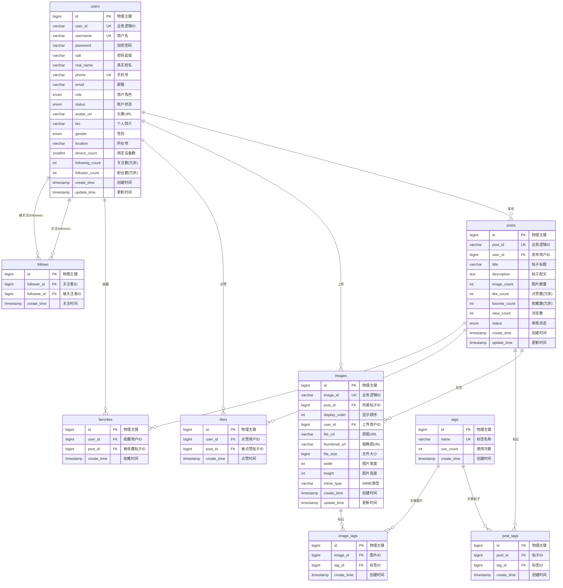

# Knot 图片分享社交平台 - 结题报告

---

## 一、需求分析

### 1.1 项目定位

**Knot** 是一款基于 HarmonyOS 平台的图片分享社交应用，致力于为用户提供一个简洁、美观的图片发现与分享社区。项目定位于移动端原生应用，面向 HarmonyOS 生态用户，提供流畅的图片浏览、发布、社交互动体验。

**核心定位**：
- 📱 **移动端原生应用** - 基于 HarmonyOS Next 开发，充分利用鸿蒙系统特性
- 🎨 **图片社交平台** - 以图片为核心的内容分享社区
- 👥 **轻量级社交** - 关注、点赞、收藏等基础社交功能
- 🏷️ **标签化内容** - 通过标签系统组织和发现内容

### 1.2 项目目的

#### 1.2.1 业务目标
- 构建一个用户体验优秀的图片分享社交平台
- 为 HarmonyOS 生态提供优质的原生社交应用
- 探索和实践 MVVM 架构在 HarmonyOS 开发中的应用
- 建立完整的前后端分离开发体系

#### 1.2.2 技术目标
- 实现规范的 MVVM 架构设计，提高代码可维护性
- 掌握 HarmonyOS Next API 的使用和最佳实践
- 实现完整的用户认证和授权机制
- 建立可扩展的 RESTful API 服务体系
- 实现高性能的图片上传、存储和展示方案

#### 1.2.3 用户价值
- 提供简洁美观的图片分享和浏览体验
- 支持多图上传（最多 9 张）和标签分类
- 实现关注、点赞、收藏等社交互动功能
- 提供个性化的内容发现和推荐

### 1.3 项目内容

#### 1.3.1 核心功能模块

**1. 用户模块**
- 用户注册与登录
- 用户资料编辑（头像、昵称、简介、性别、地区等）
- 密码修改与找回
- 个人主页展示（发布内容、关注数、粉丝数）
- 用户认证与授权（JWT Token）

**2. 帖子模块**
- 帖子发布（标题、描述、多图上传、标签）
- 帖子浏览（信息流、详情页）
- 帖子编辑与删除
- 图片预览与放大查看
- 帖子审核（状态管理：待审核/已通过/已拒绝）

**3. 社交互动模块**
- 关注/取消关注用户
- 查看关注列表和粉丝列表
- 帖子点赞/取消点赞
- 帖子收藏/取消收藏
- 查看我的点赞和收藏列表

**4. 发现模块**
- 首页信息流（时间倒序）
- 标签浏览与搜索
- 热门标签推荐
- 内容筛选与排序

**5. 个人中心模块**
- 个人资料查看与编辑
- 我的发布
- 我的收藏
- 我的关注
- 账号设置

#### 1.3.2 特色功能

- ✨ **多图上传**：支持一次上传最多 9 张图片
- 🏷️ **智能标签**：自定义标签系统，便于内容分类和发现
- 📊 **数据统计**：点赞数、收藏数、浏览数实时统计
- 🔄 **状态同步**：点赞、收藏状态实时同步
- 🎨 **精美UI**：Material Design 风格，流畅的交互动画

### 1.4 技术栈

#### 1.4.1 前端技术栈

| 技术分类 | 技术选型 | 版本 | 说明 |
|---------|---------|------|------|
| **开发框架** | HarmonyOS Next | API 12+ | 鸿蒙原生开发框架 |
| **开发语言** | ArkTS | - | TypeScript 的超集，专为 HarmonyOS 设计 |
| **UI框架** | ArkUI | - | 声明式UI开发范式 |
| **架构模式** | MVVM | - | Model-View-ViewModel 架构 |
| **网络请求** | @ohos.net.http | - | 系统原生 HTTP 模块 |
| **文件操作** | @kit.CoreFileKit | - | 文件 I/O、图片选择器 |
| **路由导航** | @kit.ArkUI | - | 页面路由和导航 |
| **数据持久化** | Preferences | - | 本地键值对存储（Token等） |
| **状态管理** | @State/@Prop/@Link | - | 状态装饰器系统 |
| **开发工具** | DevEco Studio | 5.x | 官方 IDE |

**前端架构特点**：
- 📦 **模块化设计**：按照 MVVM 分层组织代码结构
- 🔄 **响应式UI**：使用状态管理实现数据驱动视图
- 🎯 **类型安全**：全面使用 TypeScript 类型系统
- ♻️ **代码复用**：ViewModel 和 Service 层高度复用
- 🧪 **易于测试**：业务逻辑与UI解耦，便于单元测试

**目录结构**：
```
entry/src/main/ets/
├── common/                    # 公共模块
│   ├── constants/             # 常量定义
│   ├── types/                 # 类型定义
│   └── utils/                 # 工具类
│       ├── ToastUtil.ets      # Toast 提示工具
│       └── PostStateManager.ets # 帖子状态管理
│
├── models/                    # Model层：数据模型
│   └── entities/
│       ├── PostEntity.ets     # 帖子实体
│       └── PostDetailEntity.ets # 帖子详情实体
│
├── services/                  # Service层：服务和API
│   ├── api/
│   │   ├── HttpRequest.ets    # HTTP请求封装
│   │   ├── PostApi.ets        # 帖子API
│   │   ├── UserApi.ets        # 用户API
│   │   └── ApiConstants.ets   # API常量配置
│   ├── local/                 # 本地数据服务
│   └── TokenManager.ets       # Token管理
│
├── viewmodels/                # ViewModel层：业务逻辑
│   ├── AuthViewModel.ets      # 认证业务逻辑
│   ├── CreatePostViewModel.ets # 创建帖子业务逻辑
│   ├── DiscoverViewModel.ets  # 发现页业务逻辑
│   ├── PostDetailViewModel.ets # 帖子详情业务逻辑
│   ├── ProfileViewModel.ets   # 个人中心业务逻辑
│   ├── EditProfileViewModel.ets # 编辑资料业务逻辑
│   └── ChangePasswordViewModel.ets # 修改密码业务逻辑
│
├── views/                     # View层：视图组件
│   ├── components/            # 公共组件
│   │   ├── ImageCard.ets      # 图片卡片组件
│   │   ├── LoadingComponent.ets # 加载组件
│   │   └── ShareDrawer.ets    # 分享抽屉组件
│   └── pages/                 # 页面组件
│       ├── LoginPage.ets      # 登录页面
│       ├── RegisterPage.ets   # 注册页面
│       ├── DiscoverPage.ets   # 发现页面
│       ├── ProfilePage.ets    # 个人中心页面
│       ├── EditProfilePage.ets # 编辑资料页面
│       ├── ChangePasswordPage.ets # 修改密码页面
│       ├── FollowPage.ets     # 关注/粉丝列表页面
│       └── GalleryPage.ets    # 图片预览页面
│
└── pages/                     # 主页面入口
    ├── MainPage.ets           # 主页面（底部导航）
    ├── CreatePostPage.ets     # 创建帖子页面
    ├── PostDetailPage.ets     # 帖子详情页面
    └── SettingPage.ets        # 设置页面
```

#### 1.4.2 后端技术栈

> **注：后端技术栈待补充**

| 技术分类 | 技术选型 | 版本 | 说明 |
|---------|---------|------|------|
| **开发语言** | - | - | - |
| **开发框架** | - | - | - |
| **数据库** | MySQL | 8.0.43 | 关系型数据库 |
| **缓存** | - | - | - |
| **文件存储** | - | - | - |
| **认证授权** | - | - | JWT Token 机制 |
| **API规范** | RESTful API | - | 标准 REST 接口 |

### 1.5 整体架构设计

#### 1.5.1 系统架构图

```
┌─────────────────────────────────────────────────────────────────┐
│                        客户端层 (Client)                          │
│                                                                   │
│  ┌──────────────┐  ┌──────────────┐  ┌──────────────┐          │
│  │  HarmonyOS   │  │   Android    │  │     iOS      │          │
│  │     App      │  │   (未来)     │  │   (未来)     │          │
│  └──────────────┘  └──────────────┘  └──────────────┘          │
└─────────────────────────────────────────────────────────────────┘
                              ↓ HTTP/HTTPS
┌─────────────────────────────────────────────────────────────────┐
│                       API网关层 (API Gateway)                     │
│                                                                   │
│  ┌──────────────────────────────────────────────────────────┐  │
│  │  - 路由转发                                                │  │
│  │  - 身份认证 (JWT Token验证)                                │  │
│  │  - 接口限流                                                │  │
│  │  - 日志记录                                                │  │
│  └──────────────────────────────────────────────────────────┘  │
└─────────────────────────────────────────────────────────────────┘
                              ↓
┌─────────────────────────────────────────────────────────────────┐
│                        应用服务层 (Application)                   │
│                                                                   │
│  ┌──────────────┐  ┌──────────────┐  ┌──────────────┐          │
│  │   用户服务   │  │   帖子服务   │  │   社交服务   │          │
│  │              │  │              │  │              │          │
│  │ - 注册登录   │  │ - 帖子CRUD   │  │ - 关注管理   │          │
│  │ - 资料管理   │  │ - 图片上传   │  │ - 点赞管理   │          │
│  │ - 密码管理   │  │ - 标签管理   │  │ - 收藏管理   │          │
│  └──────────────┘  └──────────────┘  └──────────────┘          │
└─────────────────────────────────────────────────────────────────┘
                              ↓
┌─────────────────────────────────────────────────────────────────┐
│                        数据访问层 (Data Access)                   │
│                                                                   │
│  ┌──────────────────────────────────────────────────────────┐  │
│  │  - ORM/数据库操作                                           │  │
│  │  - 缓存管理                                                 │  │
│  │  - 数据校验                                                 │  │
│  └──────────────────────────────────────────────────────────┘  │
└─────────────────────────────────────────────────────────────────┘
                              ↓
┌─────────────────────────────────────────────────────────────────┐
│                        数据存储层 (Data Storage)                  │
│                                                                   │
│  ┌──────────────┐  ┌──────────────┐  ┌──────────────┐          │
│  │    MySQL     │  │    Redis     │  │  文件存储    │          │
│  │  关系数据库  │  │   缓存数据   │  │  (图片/附件) │          │
│  └──────────────┘  └──────────────┘  └──────────────┘          │
└─────────────────────────────────────────────────────────────────┘
```

#### 1.5.2 前端 MVVM 架构设计

```
┌─────────────────────────────────────────────────────────────────┐
│                           View 层 (视图层)                        │
│  职责：UI渲染、用户交互、状态展示                                  │
│                                                                   │
│  ┌───────────────┐  ┌───────────────┐  ┌───────────────┐       │
│  │  LoginPage    │  │  DiscoverPage │  │  ProfilePage  │       │
│  │  (登录页面)   │  │  (发现页面)   │  │  (个人中心)   │       │
│  └───────────────┘  └───────────────┘  └───────────────┘       │
│            │                 │                 │                 │
│            └─────────────────┴─────────────────┘                 │
│                              ↓                                    │
│                    数据绑定 (@State/@Link)                        │
│                    事件触发 (onClick/onChange)                    │
└─────────────────────────────────────────────────────────────────┘
                              ↕
┌─────────────────────────────────────────────────────────────────┐
│                       ViewModel 层 (业务逻辑层)                   │
│  职责：业务逻辑处理、状态管理、数据验证、流程控制                  │
│                                                                   │
│  ┌───────────────┐  ┌───────────────┐  ┌───────────────┐       │
│  │  AuthViewModel│  │DiscoverViewModel│ │ProfileViewModel│      │
│  │               │  │                │  │               │       │
│  │ - login()     │  │ - loadPosts()  │  │ - loadProfile()│      │
│  │ - register()  │  │ - refreshFeed()│  │ - editProfile()│      │
│  │ - validate()  │  │ - filterByTag()│  │ - logout()    │       │
│  └───────────────┘  └───────────────┘  └───────────────┘       │
│            │                 │                 │                 │
│            └─────────────────┴─────────────────┘                 │
│                              ↓                                    │
│                         调用 API 接口                             │
└─────────────────────────────────────────────────────────────────┘
                              ↕
┌─────────────────────────────────────────────────────────────────┐
│                        Service 层 (服务层)                        │
│  职责：API调用、数据请求、本地存储                                │
│                                                                   │
│  ┌───────────────┐  ┌───────────────┐  ┌───────────────┐       │
│  │   UserApi     │  │   PostApi     │  │ TokenManager  │       │
│  │               │  │               │  │               │       │
│  │ - login()     │  │ - getPosts()  │  │ - saveToken() │       │
│  │ - register()  │  │ - createPost()│  │ - getToken()  │       │
│  │ - getProfile()│  │ - likePost()  │  │ - clearToken()│       │
│  └───────────────┘  └───────────────┘  └───────────────┘       │
│                              ↓                                    │
│                   ┌──────────────────────┐                       │
│                   │   HttpRequest        │                       │
│                   │  (HTTP请求封装)       │                       │
│                   │                      │                       │
│                   │ - get()              │                       │
│                   │ - post()             │                       │
│                   │ - put()              │                       │
│                   │ - delete()           │                       │
│                   └──────────────────────┘                       │
└─────────────────────────────────────────────────────────────────┘
                              ↕
┌─────────────────────────────────────────────────────────────────┐
│                         Model 层 (数据模型层)                     │
│  职责：数据结构定义、实体类                                       │
│                                                                   │
│  ┌───────────────┐  ┌───────────────┐  ┌───────────────┐       │
│  │  UserEntity   │  │  PostEntity   │  │  ImageEntity  │       │
│  │               │  │               │  │               │       │
│  │ - id          │  │ - post_id     │  │ - image_id    │       │
│  │ - username    │  │ - title       │  │ - file_url    │       │
│  │ - avatar_url  │  │ - description │  │ - width       │       │
│  │ - bio         │  │ - images[]    │  │ - height      │       │
│  └───────────────┘  └───────────────┘  └───────────────┘       │
└─────────────────────────────────────────────────────────────────┘
```

**MVVM 数据流转说明**：

1. **用户操作 → View**
   - 用户在界面上进行操作（点击按钮、输入文字等）
   - View 层监听事件并更新本地 UI 状态

2. **View → ViewModel**
   - View 调用 ViewModel 的方法传递数据
   - 通过 `viewModel.setXxx()` 方法同步数据

3. **ViewModel → Service**
   - ViewModel 执行业务逻辑（验证、转换等）
   - 调用 Service 层的 API 方法

4. **Service → API**
   - Service 通过 HttpRequest 发送网络请求
   - 返回标准化的 ApiResponse

5. **API → Service → ViewModel → View**
   - 数据沿调用链路返回
   - ViewModel 处理响应并更新状态
   - View 通过数据绑定自动刷新 UI

#### 1.5.3 数据库架构设计

**数据库类型**：MySQL 8.0.43（关系型数据库）

**数据库名称**：`knot_image_sharing`

**表设计概览**：

| 表名 | 说明 | 主要字段 | 关联关系 |
|-----|------|---------|---------|
| users | 用户信息表 | id, user_id, username, password, avatar_url, bio | - |
| posts | 帖子表 | id, post_id, user_id, title, description, image_count | FK: user_id → users.id |
| images | 图片信息表 | id, image_id, post_id, file_url, thumbnail_url | FK: post_id → posts.id<br>FK: user_id → users.id |
| tags | 标签表 | id, name, use_count | - |
| post_tags | 帖子标签关联表 | id, post_id, tag_id | FK: post_id → posts.id<br>FK: tag_id → tags.id |
| image_tags | 图片标签关联表 | id, image_id, tag_id | FK: image_id → images.id<br>FK: tag_id → tags.id |
| likes | 点赞记录表 | id, user_id, post_id | FK: user_id → users.id<br>FK: post_id → posts.id |
| favorites | 收藏记录表 | id, user_id, post_id | FK: user_id → users.id<br>FK: post_id → posts.id |
| follows | 关注关系表 | id, follower_id, followee_id | FK: follower_id → users.id<br>FK: followee_id → users.id |

**数据库设计原则**：
- ✅ 第三范式（3NF）设计，减少数据冗余
- ✅ 合理的冗余字段（如 following_count, follower_count）提升查询性能
- ✅ 完善的外键约束保证数据一致性
- ✅ 索引优化（单列索引、复合索引、唯一索引）
- ✅ 软删除与硬删除结合（CASCADE 级联删除）

---

## 二、数据库设计

### 2.1 数据库表结构详细设计

#### 2.1.1 用户信息表 (users)

**表名**：`users`  
**说明**：存储用户基本信息、认证信息、个人资料

| 字段名 | 类型 | 长度 | 允许NULL | 默认值 | 说明 |
|-------|------|------|---------|--------|------|
| id | BIGINT | - | NO | AUTO_INCREMENT | 物理主键（自增） |
| user_id | VARCHAR | 36 | NO | - | 业务逻辑ID（如：USR_2025Q1_01H8S2） |
| username | VARCHAR | 50 | NO | - | 用户名（唯一） |
| password | VARCHAR | 255 | NO | - | 加密密码（password_hash） |
| salt | VARCHAR | 64 | NO | - | 密码盐值 |
| real_name | VARCHAR | 50 | NO | - | 真实姓名 |
| phone | VARCHAR | 20 | NO | - | 手机号（唯一） |
| email | VARCHAR | 100 | YES | NULL | 邮箱 |
| role | ENUM | - | NO | 'user' | 用户角色（user/admin） |
| status | ENUM | - | NO | 'active' | 账户状态（active/inactive/banned） |
| avatar_url | VARCHAR | 255 | YES | NULL | 头像URL |
| bio | VARCHAR | 500 | YES | NULL | 个人简介 |
| gender | ENUM | - | YES | NULL | 性别（male/female/other/prefer_not_to_say） |
| location | VARCHAR | 100 | YES | NULL | 所在地 |
| device_count | SMALLINT | - | NO | 0 | 绑定设备数 |
| following_count | INT | - | NO | 0 | 关注数（冗余字段） |
| follower_count | INT | - | NO | 0 | 粉丝数（冗余字段） |
| create_time | TIMESTAMP | - | NO | CURRENT_TIMESTAMP | 创建时间 |
| update_time | TIMESTAMP | - | NO | CURRENT_TIMESTAMP | 更新时间（自动更新） |

---

#### 2.1.2 帖子表 (posts)

**表名**：`posts`  
**说明**：存储用户发布的帖子信息

| 字段名 | 类型 | 长度 | 允许NULL | 默认值 | 说明 |
|-------|------|------|---------|--------|------|
| id | BIGINT | - | NO | AUTO_INCREMENT | 物理主键（自增） |
| post_id | VARCHAR | 36 | NO | - | 业务逻辑ID（如：POST_2025Q4_ABC123） |
| user_id | BIGINT | - | NO | - | 发布用户ID（外键） |
| title | VARCHAR | 255 | NO | - | 帖子标题 |
| description | TEXT | - | YES | NULL | 帖子配文/描述 |
| image_count | INT | - | NO | 0 | 图片数量 |
| like_count | INT | - | NO | 0 | 点赞数（冗余字段） |
| favorite_count | INT | - | NO | 0 | 收藏数（冗余字段） |
| view_count | INT | - | NO | 0 | 浏览数 |
| status | ENUM | - | NO | 'APPROVED' | 审核状态（PENDING/APPROVED/REJECTED） |
| create_time | TIMESTAMP | - | NO | CURRENT_TIMESTAMP | 创建时间 |
| update_time | TIMESTAMP | - | NO | CURRENT_TIMESTAMP | 更新时间（自动更新） |

---

#### 2.1.3 图片信息表 (images)

**表名**：`images`  
**说明**：存储帖子中的图片详细信息

| 字段名 | 类型 | 长度 | 允许NULL | 默认值 | 说明 |
|-------|------|------|---------|--------|------|
| id | BIGINT | - | NO | AUTO_INCREMENT | 物理主键（自增） |
| image_id | VARCHAR | 36 | NO | - | 业务逻辑ID（如：IMG_2025Q4_ABC123） |
| post_id | BIGINT | - | NO | - | 所属帖子ID（外键） |
| display_order | INT | - | NO | 0 | 显示顺序（0-8） |
| user_id | BIGINT | - | NO | - | 上传用户ID（外键） |
| file_url | VARCHAR | 500 | NO | - | 原图URL |
| thumbnail_url | VARCHAR | 500 | NO | - | 缩略图URL |
| file_size | BIGINT | - | NO | - | 文件大小（字节） |
| width | INT | - | YES | NULL | 图片宽度（像素） |
| height | INT | - | YES | NULL | 图片高度（像素） |
| mime_type | VARCHAR | 50 | NO | - | MIME类型（image/jpeg, image/png, image/webp） |
| create_time | TIMESTAMP | - | NO | CURRENT_TIMESTAMP | 创建时间 |
| update_time | TIMESTAMP | - | NO | CURRENT_TIMESTAMP | 更新时间（自动更新） |

---

#### 2.1.4 标签表 (tags)

**表名**：`tags`  
**说明**：存储系统中的所有标签

| 字段名 | 类型 | 长度 | 允许NULL | 默认值 | 说明 |
|-------|------|------|---------|--------|------|
| id | BIGINT | - | NO | AUTO_INCREMENT | 物理主键（自增） |
| name | VARCHAR | 50 | NO | - | 标签名称（唯一） |
| use_count | INT | - | NO | 0 | 使用次数（统计字段） |
| create_time | TIMESTAMP | - | NO | CURRENT_TIMESTAMP | 创建时间 |

---

#### 2.1.5 帖子标签关联表 (post_tags)

**表名**：`post_tags`  
**说明**：多对多关联表，关联帖子和标签

| 字段名 | 类型 | 长度 | 允许NULL | 默认值 | 说明 |
|-------|------|------|---------|--------|------|
| id | BIGINT | - | NO | AUTO_INCREMENT | 物理主键（自增） |
| post_id | BIGINT | - | NO | - | 帖子ID（外键） |
| tag_id | BIGINT | - | NO | - | 标签ID（外键） |
| create_time | TIMESTAMP | - | NO | CURRENT_TIMESTAMP | 创建时间 |

---

#### 2.1.6 图片标签关联表 (image_tags)

**表名**：`image_tags`  
**说明**：多对多关联表，关联图片和标签（扩展功能，当前版本未使用）

| 字段名 | 类型 | 长度 | 允许NULL | 默认值 | 说明 |
|-------|------|------|---------|--------|------|
| id | BIGINT | - | NO | AUTO_INCREMENT | 物理主键（自增） |
| image_id | BIGINT | - | NO | - | 图片ID（外键） |
| tag_id | BIGINT | - | NO | - | 标签ID（外键） |
| create_time | TIMESTAMP | - | NO | CURRENT_TIMESTAMP | 创建时间 |

---

#### 2.1.7 点赞记录表 (likes)

**表名**：`likes`  
**说明**：记录用户对帖子的点赞行为

| 字段名 | 类型 | 长度 | 允许NULL | 默认值 | 说明 |
|-------|------|------|---------|--------|------|
| id | BIGINT | - | NO | AUTO_INCREMENT | 物理主键（自增） |
| user_id | BIGINT | - | NO | - | 点赞用户ID（外键） |
| post_id | BIGINT | - | NO | - | 被点赞的帖子ID（外键） |
| create_time | TIMESTAMP | - | YES | CURRENT_TIMESTAMP | 点赞时间 |

---

#### 2.1.8 收藏记录表 (favorites)

**表名**：`favorites`  
**说明**：记录用户对帖子的收藏行为

| 字段名 | 类型 | 长度 | 允许NULL | 默认值 | 说明 |
|-------|------|------|---------|--------|------|
| id | BIGINT | - | NO | AUTO_INCREMENT | 物理主键（自增） |
| user_id | BIGINT | - | NO | - | 收藏用户ID（外键） |
| post_id | BIGINT | - | NO | - | 被收藏的帖子ID（外键） |
| create_time | TIMESTAMP | - | YES | CURRENT_TIMESTAMP | 收藏时间 |

---

#### 2.1.9 关注关系表 (follows)

**表名**：`follows`  
**说明**：记录用户之间的关注关系

| 字段名 | 类型 | 长度 | 允许NULL | 默认值 | 说明 |
|-------|------|------|---------|--------|------|
| id | BIGINT | - | NO | AUTO_INCREMENT | 物理主键（自增） |
| follower_id | BIGINT | - | NO | - | 关注者ID（A关注B，A是follower） |
| followee_id | BIGINT | - | NO | - | 被关注者ID（A关注B，B是followee） |
| create_time | TIMESTAMP | - | NO | CURRENT_TIMESTAMP | 关注时间 |

---

### 2.2 数据库 ER 图

#### 2.2.1 完整 ER 图



#### 2.2.2 ER 图说明

**实体关系**：

1. **users ↔ posts**（一对多）
   
2. **users ↔ follows**（多对多，自关联）
   
3. **users ↔ likes**（多对多）
   
4. **users ↔ favorites**（多对多）
   
5. **posts ↔ images**（一对多）
   
6. **posts ↔ tags**（多对多，通过 post_tags）
   
7. **images ↔ tags**（多对多，通过 image_tags）


---

