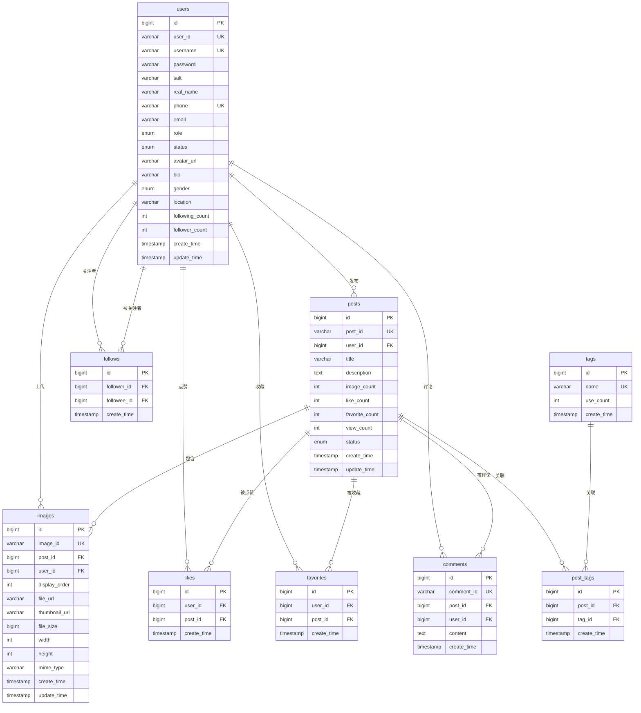
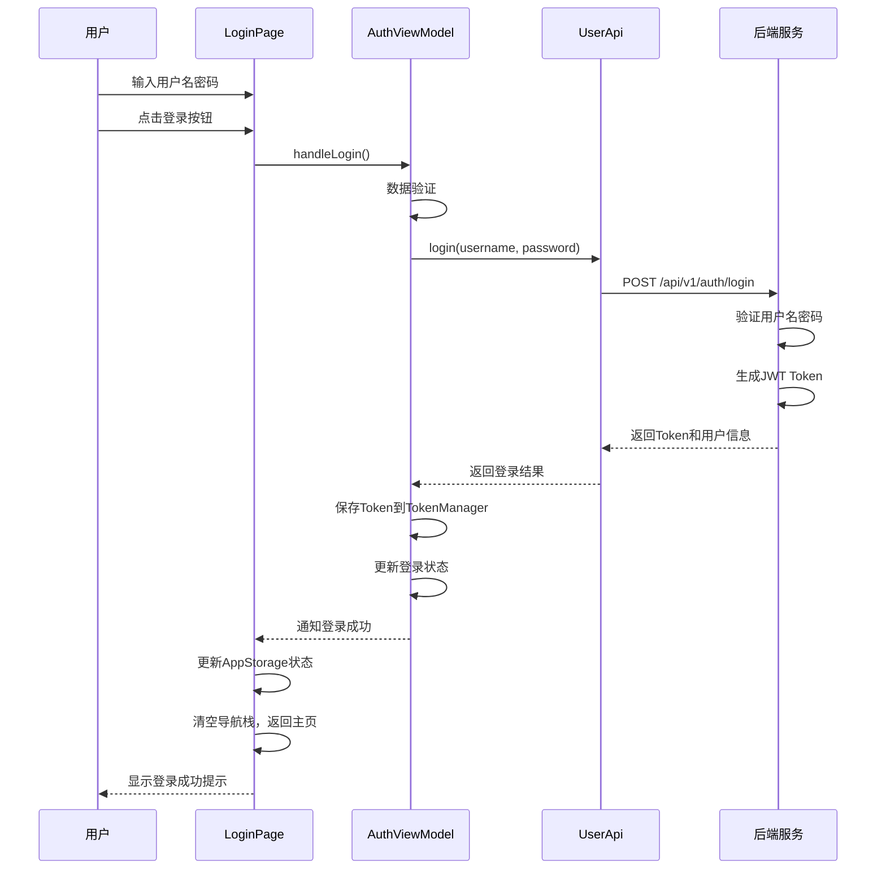
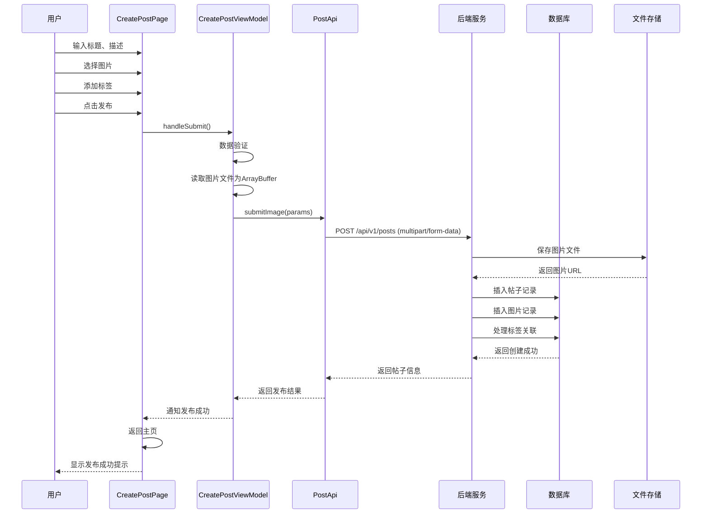
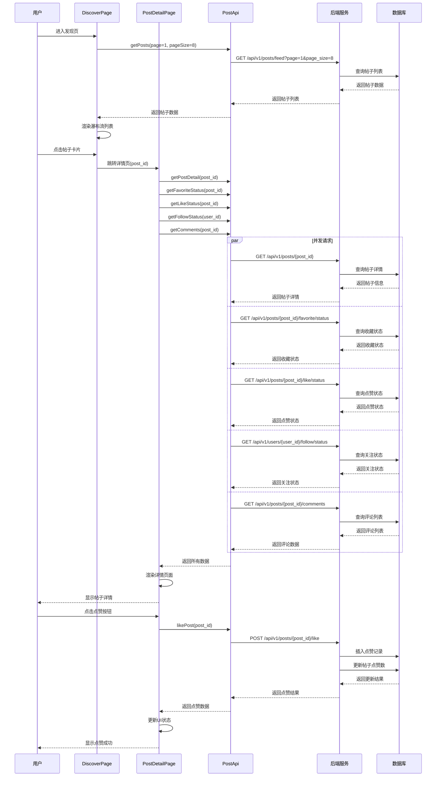
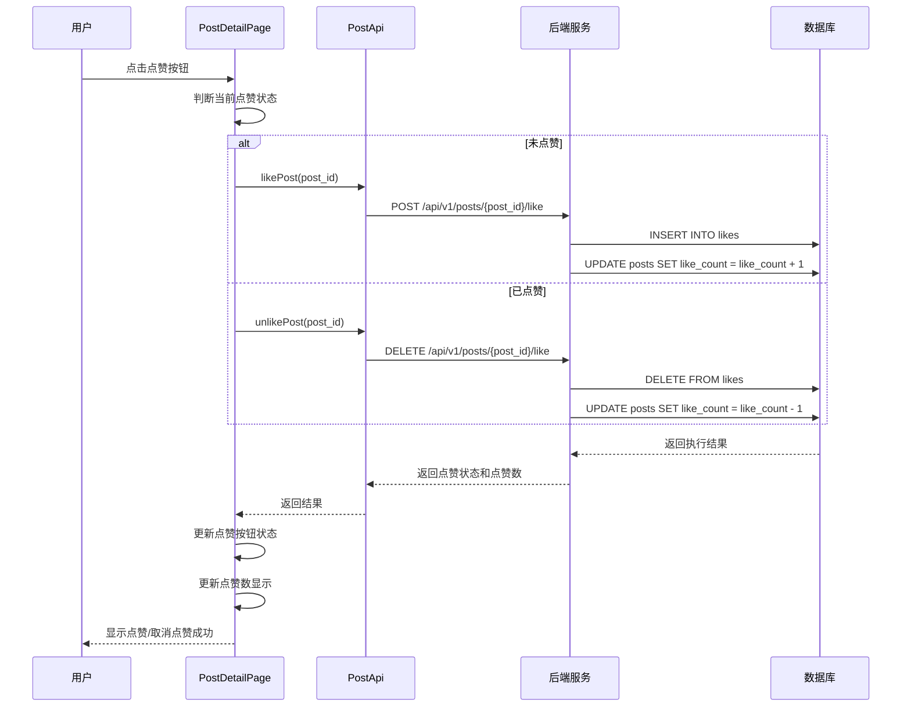
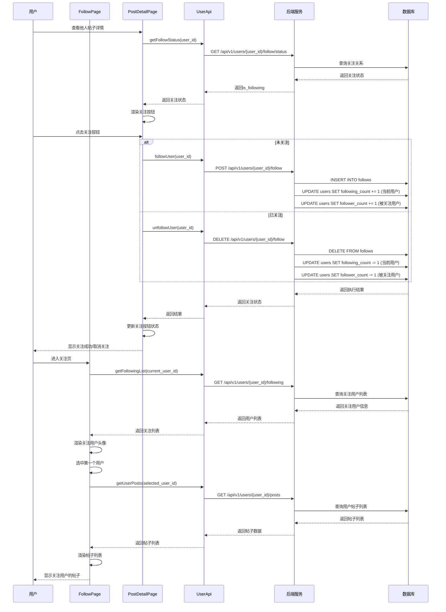
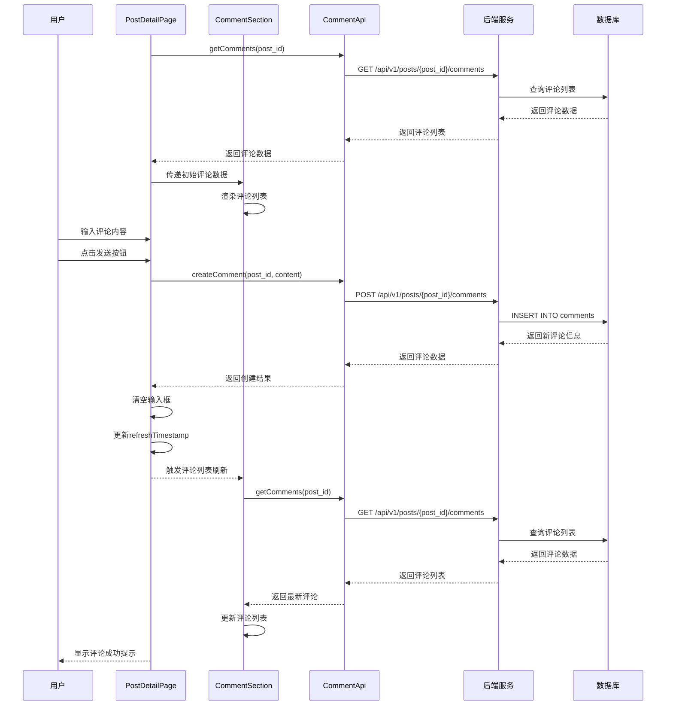
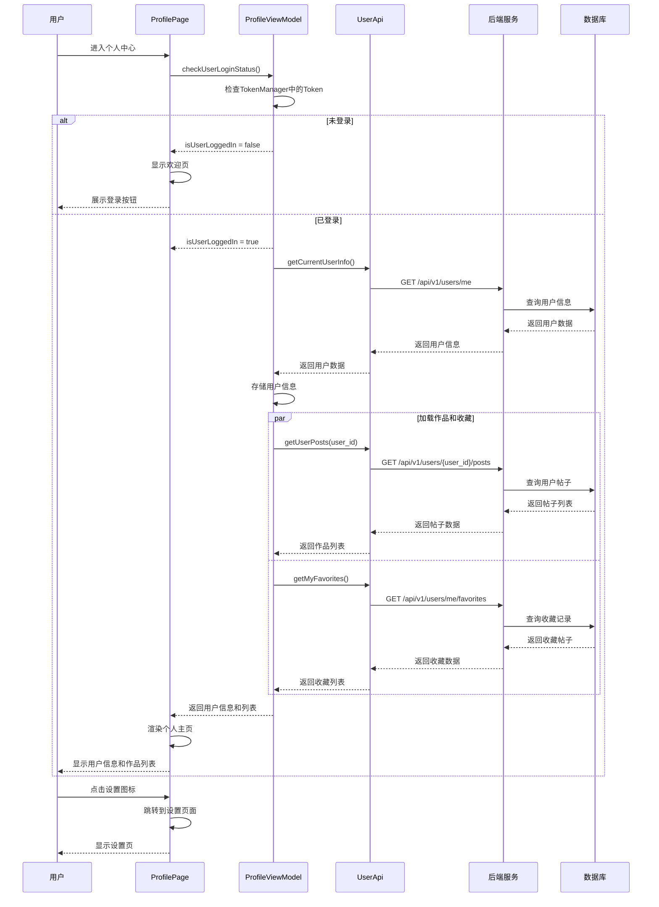

# Knot 图片分享应用 - 项目设计文档

## 一、软件定位

### 1.1 项目概述

**Knot** 是一款基于鸿蒙操作系统（HarmonyOS Next）开发的图片社交分享应用，致力于为用户提供一个优质的图片内容创作、分享和社交平台。用户可以通过应用发布图片作品、发现精彩内容、关注感兴趣的创作者，并通过点赞、收藏、评论等方式进行社交互动。

### 1.2 目标用户

- 摄影爱好者：分享摄影作品，展示摄影技巧
- 生活记录者：记录生活中的美好瞬间
- 创意设计师：展示设计作品，获取灵感
- 内容消费者：浏览精美图片，发现优质内容

### 1.3 核心价值

- **内容为王**：以高质量图片内容为核心，打造视觉盛宴
- **社交连接**：通过关注、互动机制连接志趣相投的用户
- **简洁易用**：采用瀑布流设计，提供流畅的浏览体验
- **原生体验**：基于鸿蒙原生开发，提供卓越的性能和体验

### 1.4 产品定位

**"发现生活，分享精彩"** - 一款轻量级的图片社交应用，专注于图片内容的创作与分享，为用户提供沉浸式的视觉体验和活跃的社区氛围。

---

## 二、技术栈

### 2.1 前端技术
- **开发平台**：HarmonyOS Next API 12+
- **开发语言**：ArkTS
- **UI框架**：ArkUI
- **架构模式**：MVVM架构
- **开发工具**：DevEco Studio
- **版本控制**：Git

### 2.2 后端技术
- **数据库**：MySQL 8.0
- **API风格**：RESTful API
- **认证方式**：JWT Token认证

---

## 三、已完成的核心功能

### 3.1 用户系统
- ✅ 用户注册、登录
- ✅ JWT Token认证
- ✅ 个人资料管理（头像、昵称、简介、性别、所在地）
- ✅ 密码修改
- ✅ 退出登录

### 3.2 内容创作
- ✅ 发布帖子（支持1-9张图片）
- ✅ 添加标题、描述、标签
- ✅ 图片预览、多选、删除
- ✅ multipart/form-data文件上传

### 3.3 内容发现
- ✅ 发现页瀑布流展示
- ✅ 帖子详情页（图片轮播、点赞、收藏、评论）
- ✅ 点赞/取消点赞
- ✅ 收藏/取消收藏
- ✅ 评论功能（发表评论、查看评论列表）
- ✅ 下拉刷新、上拉加载更多

### 3.4 社交互动
- ✅ 关注/取消关注用户
- ✅ 关注页（查看关注用户的帖子）
- ✅ 用户主页（查看他人公开信息和作品）
- ✅ 关注列表管理

### 3.5 个人中心
- ✅ 我的作品列表
- ✅ 我的收藏列表
- ✅ 个人信息展示
- ✅ 设置页面

---

## 四、需求分析

### 4.1 功能性需求

#### 4.1.1 用户管理

| 功能模块 | 功能描述 |
|---------|---------|
| 用户注册 | 支持用户名、密码、手机号、真实姓名注册 |
| 用户登录 | 支持用户名密码登录，Token认证 |
| 个人资料管理 | 修改头像、昵称、个人简介、性别、所在地 |
| 密码管理 | 修改密码功能 |
| 退出登录 | 安全退出登录 |

#### 4.1.2 内容创作

| 功能模块 | 功能描述 |
|---------|---------|
| 发布帖子 | 上传1-9张图片，添加标题、描述、标签 |
| 图片处理 | 图片预览、多选、删除 |
| 标签管理 | 添加、删除标签 |
| 草稿保存 | 未实现，后续可扩展 |

#### 4.1.3 内容发现

| 功能模块 | 功能描述 |
|---------|---------|
| 发现页 | 瀑布流展示所有帖子 |
| 帖子详情 | 查看帖子完整内容、图片轮播 |
| 点赞功能 | 对帖子进行点赞/取消点赞 |
| 收藏功能 | 收藏/取消收藏帖子 |
| 评论功能 | 发表评论、查看评论列表 |
| 搜索功能 | 搜索帖子和用户（UI已有，功能待实现） |

#### 4.1.4 社交互动

| 功能模块 | 功能描述 |
|---------|---------|
| 关注用户 | 关注/取消关注其他用户 |
| 关注页 | 查看关注用户的帖子列表 |
| 用户主页 | 查看自己的作品和收藏 |
| 访问他人主页 | 查看其他用户的公开信息和作品 |
| 应用内分享 | 分享帖子给互关好友（已设计，待实现） |

#### 4.1.5 个人中心

| 功能模块 | 功能描述 |
|---------|---------|
| 我的作品 | 展示用户发布的所有帖子 |
| 我的收藏 | 展示用户收藏的帖子 |
| 摄像馆 | 图片画廊展示（功能待完善） |
| 设置页面 | 个人信息编辑、密码修改、退出登录 |

### 4.2 非功能性需求

#### 4.2.1 性能要求

- 应用启动时间 < 2秒
- 页面切换响应时间 < 300ms
- 图片列表加载时间 < 1秒
- 支持下拉刷新和上拉加载更多
- 图片懒加载，优化内存占用

#### 4.2.2 安全要求

- 密码采用加盐哈希存储
- API接口采用JWT Token认证
- Token过期自动跳转登录页
- 防止SQL注入、XSS攻击
- 敏感信息不在前端暴露

#### 4.2.3 用户体验

- 遵循鸿蒙设计规范
- 提供加载状态提示
- 操作结果即时反馈（Toast提示）
- 支持手势操作（下拉刷新、滑动返回）
- 空状态友好提示

#### 4.2.4 兼容性

- 支持HarmonyOS Next API 12+
- 适配不同屏幕尺寸
- 支持深色模式（部分支持）

---

## 五、数据库表设计

### 5.1 用户表 (users)

| 字段名 | 类型 | 是否必填 | 默认值 | 说明 |
|--------|------|---------|--------|------|
| id | bigint | 是 | 自增 | 物理ID（自增主键） |
| user_id | varchar(36) | 是 | - | 逻辑ID（业务生成，例：USR_2025Q1_01H8S2） |
| username | varchar(50) | 是 | - | 用户名 |
| password | varchar(255) | 是 | - | 加密密码 |
| salt | varchar(64) | 是 | - | 密码盐值 |
| real_name | varchar(50) | 是 | - | 真实姓名 |
| phone | varchar(20) | 是 | - | 手机号 |
| email | varchar(100) | 否 | NULL | 邮箱 |
| role | enum | 是 | 'user' | 用户角色（user, admin） |
| status | enum | 是 | 'active' | 账户状态（active, inactive, banned） |
| avatar_url | varchar(255) | 否 | NULL | 头像URL |
| bio | varchar(500) | 否 | NULL | 个人简介 |
| gender | enum | 否 | NULL | 性别（male, female, other, prefer_not_to_say） |
| location | varchar(100) | 否 | NULL | 所在地 |
| device_count | smallint | 是 | 0 | 绑定设备数 |
| following_count | int | 是 | 0 | 关注数（冗余字段） |
| follower_count | int | 是 | 0 | 粉丝数（冗余字段） |
| create_time | timestamp | 是 | CURRENT_TIMESTAMP | 创建时间 |
| update_time | timestamp | 是 | CURRENT_TIMESTAMP | 更新时间 |

### 5.2 帖子表 (posts)

| 字段名 | 类型 | 是否必填 | 默认值 | 说明 |
|--------|------|---------|--------|------|
| id | bigint | 是 | 自增 | 物理ID（自增主键） |
| post_id | varchar(36) | 是 | - | 业务逻辑ID（例：POST_2025Q4_ABC123） |
| user_id | bigint | 是 | - | 发布用户ID |
| title | varchar(255) | 是 | - | 帖子标题 |
| description | text | 否 | NULL | 帖子配文 |
| image_count | int | 是 | 0 | 图片数量 |
| like_count | int | 是 | 0 | 点赞数 |
| favorite_count | int | 是 | 0 | 收藏数 |
| view_count | int | 是 | 0 | 浏览数 |
| status | enum | 是 | 'APPROVED' | 审核状态（PENDING, APPROVED, REJECTED） |
| create_time | timestamp | 是 | CURRENT_TIMESTAMP | 创建时间 |
| update_time | timestamp | 是 | CURRENT_TIMESTAMP | 更新时间 |

### 5.3 图片表 (images)

| 字段名 | 类型 | 是否必填 | 默认值 | 说明 |
|--------|------|---------|--------|------|
| id | bigint | 是 | 自增 | 物理ID（自增主键） |
| image_id | varchar(36) | 是 | - | 业务逻辑ID（例：IMG_2025Q4_ABC123） |
| post_id | bigint | 是 | - | 所属帖子ID |
| user_id | bigint | 是 | - | 上传用户ID |
| display_order | int | 是 | 0 | 显示顺序（0-8） |
| file_url | varchar(500) | 是 | - | 原图URL |
| thumbnail_url | varchar(500) | 是 | - | 缩略图URL |
| file_size | bigint | 是 | - | 文件大小（字节） |
| width | int | 否 | NULL | 图片宽度 |
| height | int | 否 | NULL | 图片高度 |
| mime_type | varchar(50) | 是 | - | MIME类型 |
| create_time | timestamp | 是 | CURRENT_TIMESTAMP | 创建时间 |
| update_time | timestamp | 是 | CURRENT_TIMESTAMP | 更新时间 |

### 5.4 点赞表 (likes)

| 字段名 | 类型 | 是否必填 | 默认值 | 说明 |
|--------|------|---------|--------|------|
| id | bigint | 是 | 自增 | 点赞记录ID |
| user_id | bigint | 是 | - | 点赞用户ID |
| post_id | bigint | 是 | - | 被点赞的帖子ID |
| create_time | timestamp | 否 | CURRENT_TIMESTAMP | 点赞时间 |

### 5.5 收藏表 (favorites)

| 字段名 | 类型 | 是否必填 | 默认值 | 说明 |
|--------|------|---------|--------|------|
| id | bigint | 是 | 自增 | 收藏记录ID |
| user_id | bigint | 是 | - | 收藏用户ID |
| post_id | bigint | 是 | - | 被收藏的帖子ID |
| create_time | timestamp | 否 | CURRENT_TIMESTAMP | 收藏时间 |

### 5.6 关注表 (follows)

| 字段名 | 类型 | 是否必填 | 默认值 | 说明 |
|--------|------|---------|--------|------|
| id | bigint | 是 | 自增 | 物理ID（自增主键） |
| follower_id | bigint | 是 | - | 关注者ID（A关注B，A是follower） |
| followee_id | bigint | 是 | - | 被关注者ID（A关注B，B是followee） |
| create_time | timestamp | 是 | CURRENT_TIMESTAMP | 关注时间 |

### 5.7 标签表 (tags)

| 字段名 | 类型 | 是否必填 | 默认值 | 说明 |
|--------|------|---------|--------|------|
| id | bigint | 是 | 自增 | 物理ID（自增主键） |
| name | varchar(50) | 是 | - | 标签名称 |
| use_count | int | 是 | 0 | 使用次数 |
| create_time | timestamp | 是 | CURRENT_TIMESTAMP | 创建时间 |

### 5.8 帖子标签关联表 (post_tags)

| 字段名 | 类型 | 是否必填 | 默认值 | 说明 |
|--------|------|---------|--------|------|
| id | bigint | 是 | 自增 | 物理ID（自增主键） |
| post_id | bigint | 是 | - | 帖子ID |
| tag_id | bigint | 是 | - | 标签ID |
| create_time | timestamp | 是 | CURRENT_TIMESTAMP | 创建时间 |

### 5.9 评论表 (comments)

| 字段名 | 类型 | 是否必填 | 默认值 | 说明 |
|--------|------|---------|--------|------|
| id | bigint | 是 | 自增 | 评论记录ID |
| comment_id | varchar(36) | 是 | - | 业务逻辑ID |
| post_id | bigint | 是 | - | 所属帖子ID |
| user_id | bigint | 是 | - | 评论用户ID |
| content | text | 是 | - | 评论内容 |
| create_time | timestamp | 是 | CURRENT_TIMESTAMP | 创建时间 |

### 5.10 数据库ER图



---

## 六、功能设计

### 6.1 用户注册与登录

#### 6.1.1 功能流程说明

**注册流程：**
1. 用户输入注册信息（用户名、密码、真实姓名、手机号、邮箱）
2. 前端验证后提交注册请求
3. 后端验证唯一性、密码加盐哈希存储、生成用户ID
4. 返回注册成功

**登录流程：**
1. 用户输入用户名和密码
2. 后端验证并生成JWT Token
3. 前端存储Token并跳转到主页

#### 6.1.2 时序图



---

### 6.2 发布帖子

#### 6.2.1 功能流程说明

1. 用户进入发布页面，输入标题、描述（可选）
2. 选择1-9张图片，添加标签（可选）
3. 前端读取图片文件并构建multipart/form-data格式
4. 提交到后端，保存图片、创建帖子记录、处理标签
5. 返回主页并刷新列表

#### 6.2.2 时序图



---

### 6.3 发现页与帖子详情

#### 6.3.1 功能流程说明

**发现页流程：**
1. 加载帖子列表，以瀑布流形式展示
2. 支持下拉刷新、上拉加载更多
3. 点击帖子卡片进入详情页

**帖子详情流程：**
1. 并发请求帖子详情、收藏状态、点赞状态、关注状态、评论列表
2. 展示图片轮播、内容信息、作者信息
3. 支持点赞、收藏、评论、分享操作

#### 6.3.2 时序图



---

### 6.4 点赞与收藏

#### 6.4.1 功能流程说明

**点赞流程：**
1. 用户点击点赞按钮
2. 前端根据当前状态调用点赞/取消点赞接口
3. 后端更新likes表和帖子点赞数
4. 前端更新UI状态

**收藏流程：**
1. 用户点击收藏按钮
2. 前端根据当前状态调用收藏/取消收藏接口
3. 后端更新favorites表和帖子收藏数
4. 前端更新UI并显示提示

#### 6.4.2 时序图



---

### 6.5 关注系统

#### 6.5.1 功能流程说明

**关注用户流程：**
1. 用户点击关注按钮
2. 后端更新follows表和用户关注数
3. 前端更新按钮状态

**关注页展示流程：**
1. 加载并展示关注用户列表（默认显示前6个）
2. 选中用户后加载其帖子列表
3. 支持切换用户和取消关注操作

#### 6.5.2 时序图



---

### 6.6 评论功能

#### 6.6.1 功能流程说明

1. 用户输入评论内容并发送
2. 后端插入评论记录并返回
3. 前端刷新评论列表并显示提示

#### 6.6.2 时序图



---

### 6.7 个人中心

#### 6.7.1 功能流程说明

**个人主页展示：**
1. 检查登录状态，未登录显示欢迎页
2. 已登录则获取用户信息并展示
3. 分Tab展示"我的作品"和"我的收藏"

**作品列表与收藏列表：**
1. 获取对应数据并以瀑布流形式展示
2. 支持刷新、加载更多
3. 点击卡片进入帖子详情

#### 6.7.2 时序图



---

## 七、亮点设计

### 7.1 MVVM架构模式

**设计理念：**
- 采用标准的MVVM架构，实现UI层与业务逻辑的完全解耦
- Model层：定义数据结构（Entity）
- Service层：封装API调用和数据存储
- ViewModel层：处理业务逻辑、状态管理、数据验证
- View层：专注于UI渲染和用户交互

### 7.2 HTTP请求封装

**设计特点：**
- 统一的请求封装，支持JSON和multipart/form-data
- 自动添加认证Token到请求头
- 统一的响应格式处理
- 完善的错误处理机制
- 支持Token过期自动跳转登录

### 7.3 瀑布流布局

**实现方式：**
- 使用HarmonyOS的WaterFlow组件
- 双列瀑布流展示，自适应图片高度
- 根据图片原始宽高比计算显示高度
- 支持下拉刷新和上拉加载更多
- 平滑的滚动体验

### 7.4 状态同步机制

**设计方案：**
- 使用PostStateManager管理帖子状态（点赞、收藏）
- 从详情页返回时自动同步状态到列表页
- 使用AppStorage实现跨页面状态共享
- 支持登录/退出登录的全局状态更新

### 7.5 并发请求优化

**设计思路：**
- 在帖子详情页，使用Promise.all并发请求多个接口
- 同时获取帖子详情、收藏状态、点赞状态、关注状态、评论列表
- 减少页面加载时间，提升用户体验

### 7.6 图片预览功能

**功能特性：**
- 点击图片进入全屏预览
- 支持图片轮播和缩放
- 支持手势滑动切换图片
- 下滑关闭预览
- 流畅的过渡动画

### 7.7 分享功能设计

**设计亮点：**
- 支持多种分享方式（应用内分享、外部分享）
- 动态生成分享卡片预览
- 支持分享给互关好友
- 分享记录持久化存储（设计已完成）

---

## 八、可能存在的问题

### 8.1 性能问题

#### 8.1.1 图片加载性能

**问题描述：**
- 瀑布流一次性加载过多图片可能导致内存占用过高
- 大图加载慢影响用户体验
- 没有图片缓存机制

**解决方案：**
- 实现图片懒加载机制
- 使用缩略图代替原图
- 实现图片缓存策略（内存缓存 + 磁盘缓存）
- 对超大图片进行压缩处理

#### 8.1.2 列表滚动性能

**问题描述：**
- 长列表滚动可能出现卡顿
- ForEach渲染大量数据性能下降

**解决方案：**
- 使用LazyForEach代替ForEach
- 实现虚拟滚动
- 限制每页加载数量
- 优化图片渲染

### 8.2 数据一致性问题

#### 8.2.1 点赞数同步问题

**问题描述：**
- 多个用户同时点赞，可能导致点赞数不一致
- 前端显示的点赞数与后端实际数据不同步

**解决方案：**
- 后端使用事务和乐观锁保证数据一致性
- 前端定期刷新获取最新数据
- 使用WebSocket实现实时同步（后续优化）

#### 8.2.2 状态同步延迟

**问题描述：**
- 从详情页返回列表页，状态更新可能有延迟
- 跨页面状态同步不够实时

**解决方案：**
- 使用PostStateManager统一管理状态
- 利用页面生命周期onPageShow同步状态
- 考虑引入响应式状态管理库

---

## 九、结论

### 9.1 项目总结

**Knot图片分享应用**是一款基于鸿蒙原生开发的图片社交应用，采用MVVM架构模式，实现了完整的用户认证、内容创作、内容发现、社交互动等核心功能。

**项目优势：**
-  鸿蒙原生应用，性能优越
-  清晰的架构设计，代码规范
-  优雅的UI设计，用户体验佳
-  完善的功能模块，满足基本需求
-  详细的文档，便于维护

---

## 附录

### B. API接口清单

详见后端API文档。

### C. 项目文件结构

```
Knot/
├── AppScope/                      # 应用全局资源
├── entry/                         # 主模块
│   ├── src/main/
│   │   ├── ets/
│   │   │   ├── common/           # 公共模块
│   │   │   │   ├── constants/    # 常量定义
│   │   │   │   ├── types/        # 类型定义
│   │   │   │   └── utils/        # 工具类
│   │   │   ├── entryability/     # 入口能力
│   │   │   ├── models/           # 数据模型
│   │   │   │   └── entities/     # 实体类
│   │   │   ├── pages/            # 主要页面
│   │   │   ├── services/         # 服务层
│   │   │   │   └── api/          # API接口
│   │   │   ├── viewmodels/       # ViewModel层
│   │   │   └── views/            # 视图组件
│   │   │       ├── components/   # 公共组件
│   │   │       └── pages/        # 子页面
│   │   ├── module.json5          # 模块配置
│   │   └── resources/            # 资源文件
├── docs/                          # 项目文档
├── oh_modules/                    # 依赖模块
├── build-profile.json5            # 构建配置
└── oh-package.json5               # 包配置
```

### D. 关键代码示例

请参考项目源代码和MVVM架构实战教程。

